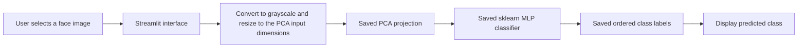

# Architecture Overview

This repository contains two related PCA and ANN experiments plus a Streamlit image-prediction interface. The deployed entry point is configured by the hosting service; the README uses `streamlit_app.py` for local launch.

## Runtime flow

The runtime loads `model.pkl`, `pca.pkl`, and `labels.pkl` from the repository. These are trusted project artifacts; joblib/pickle files can execute code when loaded, so replace them only with files from a trusted training process. Artifacts are cached by Streamlit between reruns.

## Training paths

- `train_model.py` trains scikit-learn PCA and `MLPClassifier` artifacts from `dataset/faces`, using 100 × 100 grayscale images.
- `src/train.py` is a separate custom PCA/ANN training experiment. Its image loader uses the 64 × 64 size in `src/utils.py` and writes artifacts under `outputs/models/`.
- `app.py` and `streamlit_app.py` load the root-level sklearn artifacts. They infer the square grayscale input dimensions from the saved PCA object rather than assuming a size in the UI.

The two training paths do not share the same artifacts or input dimensions. Keep each model paired with the preprocessing and labels produced by its own training run.

## Evaluation

`outputs/predictions/classification_report.txt` is a recorded result for one evaluation run, not a guarantee of performance on new people, images, lighting, or camera conditions. The live interface reports a class prediction; classifier confidence is not a validated measure of real-world recognition accuracy.

## Privacy and use

Face images and predictions are biometric data. Use only images collected with appropriate consent, limit access to the dataset and saved artifacts, and delete them when no longer needed. This classroom prototype is not an identity-verification or access-control system.
